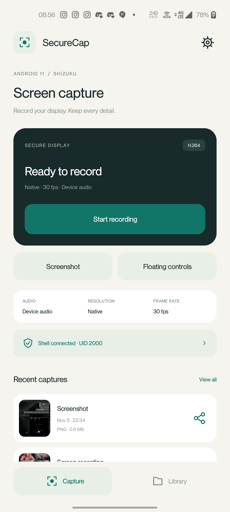
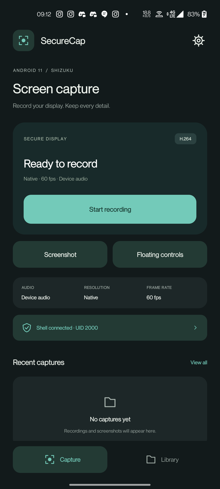

# SecureCap

[](LICENSE)


An open-source Android 11 screen recorder that can bypass FLAG_SECURE. Capture your screen, take screenshots, and record device audio using Shizuku's shell access.

**Package:** `com.uzair.securecap` · **License:** MIT

## Screenshots

| Light | Dark |
| :---: | :---: |
|  |  |

## Features

- **Secure screen capture:** includes `FLAG_SECURE` windows on compatible Android 11 devices.
- **Recording:** H.264 video in MP4, with device audio, microphone audio, or audio disabled.
- **Floating toolbar:** movable start/stop, pause/resume, timer, and screenshot controls.
- **Quick access:** Quick Settings tile and persistent notification actions.
- **Screenshots:** full-resolution PNG capture using the secure-display engine.
- **Capture settings:** longest edge, 30/60 fps, bitrate, and start delay.
- **Local library:** thumbnails, playback, image preview, sharing, and deletion.
- **Appearance:** light, dark, or system theme.
- **Local storage:** recordings in `Movies/SecureCap/`, screenshots in `Pictures/SecureCap/`.

Native Java UI with custom line icons. No accounts, advertising, analytics, or app network permission.

## Requirements

- **Android 11 (API 30)** for the secure capture engine.
- [Shizuku](https://shizuku.rikka.app/download/) running through ADB or wireless debugging.
- Shizuku permission granted to SecureCap.
- An unlocked screen when starting audio capture.
- Display-over-other-apps permission to use floating controls.

Verified on a **OnePlus 8T (KB2007), Android 11**, using `dev.uzair.flagtest`. See [device verification](docs/device-verification.md).

## Getting started

1. Install SecureCap from a built APK (Available in Releases).
2. Start Shizuku. On Android 11, wireless debugging can start it directly on the phone; USB ADB is also supported. Follow the [Shizuku setup guide](https://shizuku.rikka.app/guide/setup/).
3. Open SecureCap and tap the connection row to authorize Shizuku. A successful connection shows **Shell connected · UID 2000**.
4. Open **Capture settings** and grant overlay permission for floating controls.
5. Choose your audio source, resolution, frame rate, bitrate, and start delay.
6. Tap **Start recording**, or show the floating controls. Stop from the toolbar, app, notification, or Quick Settings tile.

To add the tile, open your Quick Settings panel, enter its tile editor, and add **SecureCap**. To change themes, open **Capture settings → Appearance**.

Shizuku needs to be restarted after a device reboot when using ADB mode.

## How capture works

SecureCap runs its capture engine in a **Shizuku user service**, under the shell UID. On Android 11, the hidden `SurfaceControl.createDisplay(..., true)` API creates a secure virtual display that can compose secure window layers. That display feeds a hardware video encoder or an ImageReader for PNG screenshots.

Device audio is recorded through **`REMOTE_SUBMIX`**, then encoded as AAC and muxed into the MP4. The app passes a writable MediaStore file descriptor to the shell service and publishes the file after recording finishes.

The implementation is informed by Android source and scrcpy's capture architecture. Source links and the Android-version differences are documented in [capture research](docs/capture-research.md).

### Behavior and compatibility

- **Android 12 and later:** secure-display creation is restricted to system/graphics UIDs, so this Android 11 shell capture path is unavailable.
- **ROM differences:** vendor changes can affect secure layers and audio routing. `FLAG_SECURE` windows and hardware-protected DRM buffers are different mechanisms; DRM capture is not guaranteed.
- **Device audio:** remote submix redirects playback away from the phone while capturing. A shell popup briefly appears when starting audio on Android 11 to satisfy its foreground requirement.
- **Audio initialization errors:** the error is reported rather than silently producing a video-only recording. Choose **No audio** to record without an audio track.
- **Rotation:** the recording retains its initial dimensions. Orientation changes are fitted into that frame without stretching.
- **Pause:** paused time is removed from audio and video, and resume requests a new video keyframe.

## Build from source

### Toolchain

| Component | Version |
| --- | --- |
| JDK | 17 |
| Gradle | 8.11.1, included wrapper |
| Android Gradle Plugin | 8.7.3 |
| Compile SDK | 35 |
| Build tools | 34.0.0 |
| Minimum / target SDK | 30 / 30 |
| Shizuku API | 13.1.5 |

Open the project in Android Studio, or configure the Android SDK through `ANDROID_HOME` or an untracked `local.properties` file:

```properties
sdk.dir=/path/to/Android/Sdk
```

Then build and check the project:

```sh
./gradlew assembleDebug lintDebug
adb install -r --user 0 app/build/outputs/apk/debug/app-debug.apk
```

The debug APK is generated at `app/build/outputs/apk/debug/app-debug.apk`. The GitHub Actions workflow builds it and uploads it as a workflow artifact. Debug artifacts use a development signing key; sign release APKs with your own stable key before distributing updates.

## Testing the capture engine

The APK includes an ADB-only `CaptureProbe` entry point that exercises the same engine used by Shizuku. With the phone unlocked and your test app open:

```sh
adb push app/build/outputs/apk/debug/app-debug.apk /data/local/tmp/securecap.apk
adb shell am start -n dev.uzair.flagtest/.MainActivity

# Screenshot
adb shell 'CLASSPATH=/data/local/tmp/securecap.apk app_process /system/bin com.uzair.securecap.engine.CaptureProbe screenshot /data/local/tmp/securecap-test.png'

# Ten-second recording with device audio and a pause/resume interval
adb shell 'CLASSPATH=/data/local/tmp/securecap.apk app_process /system/bin com.uzair.securecap.engine.CaptureProbe record /data/local/tmp/securecap-test.mp4 device pause'

adb pull /data/local/tmp/securecap-test.png
adb pull /data/local/tmp/securecap-test.mp4
```

Replace `dev.uzair.flagtest` with your own test app when needed. Check output with a media player or `ffprobe`; audio needs an audible source to verify its content.

## Project layout

```text
app/src/main/
├── aidl/                       Binder interface for the capture engine
├── java/com/uzair/securecap/
│   ├── engine/                 Secure display, video/audio encoding, screenshots
│   ├── ui/                     Icons, palette, theme-aware activity base
│   ├── CaptureService.java     Recording lifecycle and notification controls
│   ├── FloatingControls.java   Movable overlay toolbar
│   └── MainActivity.java       Capture screen, settings, and local library
└── res/                        Light/dark themes and vector assets
docs/                           Research, verification, and screenshots
```

## Contributing

Issues and pull requests are welcome. See [CONTRIBUTING.md](CONTRIBUTING.md) for the build checks and useful device-test details.

## Credits and license

Built by **[Uzair Mughal](https://uzair.is-a.dev)**.

- [Shizuku](https://github.com/RikkaApps/Shizuku-API) for shell-privileged user services.
- [scrcpy](https://github.com/Genymobile/scrcpy) for its documented screen/audio capture architecture.
- [Android Open Source Project](https://source.android.com/) for the platform source.

SecureCap is released under the **[MIT License](LICENSE)**. Dependencies retain their own licenses; see [third-party notices](THIRD_PARTY_NOTICES.md).
